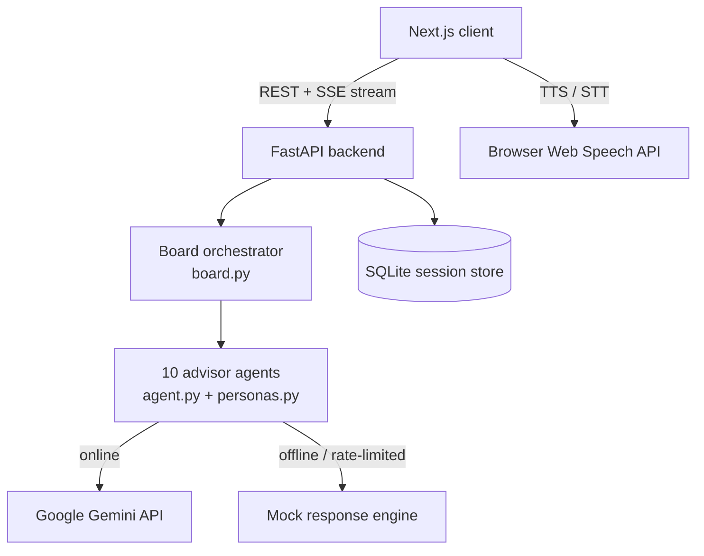

# FounderOS: Multi-Agent Advisory Boardroom

Pitch a startup idea to a board of 10 AI advisors. They critique it from their own angle, cross-examine each other, and vote, all streamed live into an interactive boardroom.

Built for the **Google AI Hackathon 2026**.


---

## What it does

1. The founder submits a pitch (typed or dictated by voice).
2. Ten advisor agents, each with its own system prompt, incentives and biases, review it in sequence: CEO, CTO, Investor, Product Manager, Marketing, Legal, Finance, Security, UX and Competition.
3. Advisors respond to each other's points, then each casts a structured vote: **Approve**, **Conditionally Approve** or **Reject**.
4. The votes are combined into a weighted viability score. The founder can change advisor weights in the Sandbox tab and recalculate instantly.
5. The finished session can be exported as JSON, Markdown or HTML and revisited later in the Strategy Vault.

## Key features

- **Live debate streaming.** The backend streams each advisor's turn to the UI over Server-Sent Events, so the debate plays out in real time rather than arriving as one block.
- **Interactive boardroom visualisation.** An HTML5 Canvas view shows each advisor's state (waiting, thinking, speaking, reviewing) and draws links between agents as consensus forms.
- **Voice in and out.** Advisors read their critiques aloud with distinct voices, and founders can answer by speaking, using the browser's built-in Web Speech API with no extra dependencies.
- **Follow-up tools.** Chat one-on-one with any advisor, and run a Pitch Drill that evaluates your answers to tough questions.
- **Offline demo mode.** When the Gemini API is unavailable or rate-limited, the backend falls back to local mock responses so the demo never breaks.
- **Persistent sessions.** Boardroom sessions are stored in SQLite behind a repository interface, so the storage layer can be swapped out.

## Architecture



| Layer | Stack |
|---|---|
| Frontend | Next.js 16, React 19, TypeScript, Tailwind CSS, HTML5 Canvas |
| Backend | Python 3.12, FastAPI, Uvicorn, Pydantic v2, pydantic-settings |
| AI | Google GenAI SDK (default model `gemini-2.0-flash-lite`, configurable) |
| Storage | SQLite (repository pattern; an in-memory implementation is also included) |
| DevOps | Docker, Docker Compose, GitHub Actions (pytest + TypeScript type check) |

## Getting started

### Option 1: Docker (quickest)

```bash
git clone https://github.com/Bhanoday777/FounderOS.git
cd FounderOS
docker compose up --build
```

Open http://localhost:3000. Compose runs the backend in offline demo mode by default, so no API key is needed.

### Option 2: Run locally

**Backend**

```bash
cd backend
python -m venv .venv
# Windows: .venv\Scripts\activate
# macOS / Linux: source .venv/bin/activate
pip install -r requirements.txt
```

Create `backend/.env`:

```env
GEMINI_API_KEY=your_key_here
GEMINI_MODEL=gemini-2.0-flash-lite
OFFLINE_DEMO=false   # set to true to run without an API key
```

Start the API:

```bash
uvicorn app.main:app --reload --port 8000
```

**Frontend** (in a second terminal)

```bash
cd frontend
npm install
npm run dev
```

Open http://localhost:3000. The frontend expects the API at `http://localhost:8000`. Set `NEXT_PUBLIC_API_URL` to point it elsewhere.

### Running tests

```bash
cd backend
pytest
```

The same suite, plus a frontend type check, runs on every push through GitHub Actions.

## API overview

| Method | Endpoint | Purpose |
|---|---|---|
| `POST` | `/api/board/session` | Create a boardroom session from a pitch |
| `GET` | `/api/board/session/{id}/stream` | Stream the debate (SSE) |
| `GET` | `/api/board/session/{id}` | Fetch a session |
| `GET` | `/api/board/sessions` | List past sessions |
| `POST` | `/api/board/session/{id}/recalculate` | Re-score with custom advisor weights |
| `POST` | `/api/board/session/{id}/chat` | Chat with an individual advisor |
| `POST` | `/api/board/session/{id}/drill/evaluate` | Evaluate a Pitch Drill answer |
| `GET` | `/api/board/session/{id}/export/{json,markdown,html}` | Export a session |

## Project structure

```text
FounderOS/
├── backend/
│   ├── app/
│   │   ├── main.py            # REST and SSE endpoints
│   │   ├── config.py          # Settings (env vars, advisor weights)
│   │   ├── core/
│   │   │   ├── board.py       # Debate orchestration and consensus scoring
│   │   │   ├── agent.py       # Advisor agent: LLM calls and offline fallback
│   │   │   └── personas.py    # System prompts for the 10 advisors
│   │   ├── database/          # Repository interface, SQLite and in-memory stores
│   │   └── schemas/           # Pydantic models
│   └── tests/                 # pytest suite
├── frontend/
│   └── src/
│       ├── app/               # Pages: home, boardroom/[id], advisors, vault, docs
│       ├── components/boardroom/  # Boardroom canvas, debate feed, votes, sandbox, drill
│       └── lib/               # API client, speech helpers
├── docker-compose.yml
└── .github/workflows/ci.yml
```

Key files: [`board.py`](backend/app/core/board.py), [`agent.py`](backend/app/core/agent.py), [`personas.py`](backend/app/core/personas.py), [`main.py`](backend/app/main.py), [`speech.ts`](frontend/src/lib/speech.ts).

## Author

**Bhanoday Kurma**, [GitHub](https://github.com/Bhanoday777)
